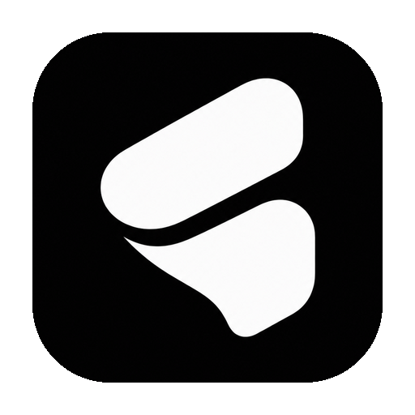
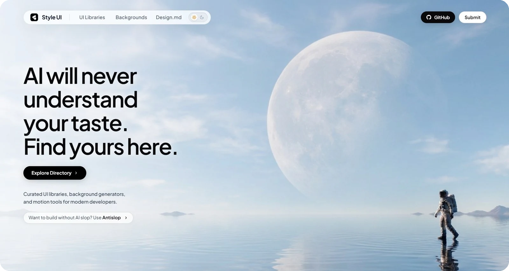

<h1 align="center">
  
   
  Style UI
</h1>

A directory of UI component libraries, design.md generators, and background generators.

  
  
  

  

Style UI lists 57 tools across three categories. Every entry links to the original product, shows a screenshot, and marks its pricing model: Free, Semi-free, or Paid. Nothing is hosted here, and browsing needs no account.

> Official source: [github.com/miqdadbadjuber/style-ui](https://github.com/miqdadbadjuber/style-ui). Official site: [style.ai.id](https://style.ai.id).

## Catalog

| Category | Entries | Page |
| --- | ---: | --- |
| UI components and libraries | 47 | [style.ai.id/ui-components](https://style.ai.id/ui-components) |
| Background and shader generators | 6 | [style.ai.id/background-generator](https://style.ai.id/background-generator) |
| Design.md generators | 4 | [style.ai.id/design-md](https://style.ai.id/design-md) |

Each card carries one of three labels:

| Label | Meaning |
| --- | --- |
| Free | The full product is available at no cost. |
| Semi&#8209;free | Free with conditions, such as an account, a usage limit, or only part of the product. |
| Paid | Payment is required. Some products offer a trial. |

Each category page has search, a pricing filter, and cards with a live preview. The homepage carries a Top Today rail and the same cards in three rows. The site runs on plain HTML, CSS, and JavaScript with no build step.

## Contributing

- Submit a tool with the [submission form](https://github.com/miqdadbadjuber/style-ui/issues/new?template=submit-tool.yml).
- Report a broken link or a layout bug with the [bug report form](https://github.com/miqdadbadjuber/style-ui/issues/new?template=bug-report.yml).
- Ask questions or share tools in the [Discord server](https://discord.gg/VWKggJfHFR).
- Read [CONTRIBUTING.md](CONTRIBUTING.md) before opening a pull request. Local setup and the validation command are covered there.
- Follow the [Code of Conduct](CODE_OF_CONDUCT.md) in every discussion.
- Report security issues privately, as described in [SECURITY.md](SECURITY.md).

Planned work lives in [ROADMAP.md](ROADMAP.md).

## Attribution

Style UI is an independent directory. Product names, logos, and screenshots belong to their respective owners and appear here for identification only. No affiliation or endorsement is implied. If you own a listed product and want the entry corrected or removed, open an issue.

## Privacy

No accounts, no cookies, no analytics. [PRIVACY.md](PRIVACY.md) lists the two local storage keys and the third-party requests.

## License

MIT. See [LICENSE](LICENSE).
